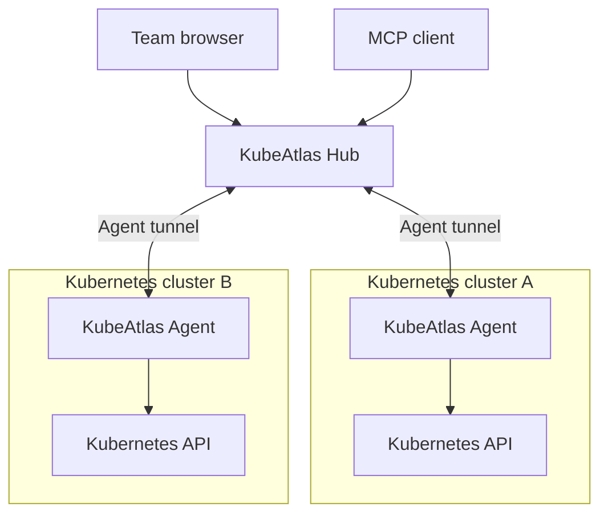

# KubeAtlas

**English** · [简体中文](README.zh-CN.md)

**A self-hosted operations console for Kubernetes.** Connect your clusters to one Hub to find failing workloads, trace dependencies, and see what changed.

[Download](https://github.com/maomada/KubeAtlas/releases/latest) · [Try one cluster](#try-one-cluster) · [Deploy the Hub](#deploy-the-hub) · [Deploy with an AI agent](docs/deploy-with-ai.md)



**Hub** hosts the web console and manages organizations, cluster access, and MCP credentials. **Agent** runs in each cluster and opens an outbound connection to Hub. Cluster operations are scoped to the selected organization and enforced by Kubernetes RBAC.

## What you can do

- **Investigate issues** with workload health, logs, events, and a timeline of resource changes. [Cluster checks](docs/cluster-checks.md) · <a name="kubernetes-upgrade-impact"></a>[Upgrade impact checks](docs/upgrade-impact.md)
- **Explore applications** and their resource dependencies, inspect live traffic when a source is available, and review Helm releases and Argo CD or Flux sync status. [Integrations](docs/integrations.md)
- **Review capacity and cost** with scheduling requests, node capacity, and cost allocation. If the cluster has a compatible Prometheus and the Hub has an offline bundle, you can install OpenCost from the Cost page. [Capacity](docs/capacity.md) · [Offline OpenCost](docs/opencost-offline.md)
- **Connect an AI client** over MCP using an expiring credential scoped to selected clusters and your permissions. [Hub MCP](docs/hub-live-mcp.md)

## Get started

The [latest stable release](https://github.com/maomada/KubeAtlas/releases/latest) provides Linux DEB and RPM packages for `amd64` and `arm64`. Choose `kubeatlas` for a local console or `kubeatlas-portal` for a shared Hub.

### Try one cluster

Download the matching `kubeatlas` package and `checksums.txt` from the release. Verify the downloaded file, install it, and open `http://127.0.0.1:9280`. KubeAtlas uses your kubeconfig.

```sh
# Debian or Ubuntu on amd64, using v0.1.2 as an example
package=kubeatlas_0.1.2_linux_amd64.deb
awk -v name="$package" '$2 == name' checksums.txt | sha256sum --check - &&
  sudo apt install "./$package" &&
  kubeatlas --listen-address 127.0.0.1 --port 9280 --no-browser
```

On an RPM-based distribution, install the verified RPM with `sudo rpm -i ./<package>.rpm`. See [package installation](docs/packaging.md) or [run from source](DEVELOPMENT.md#quick-start).

### Deploy the Hub

1. Starting with `v0.1.2`, download the matching `kubeatlas-portal` DEB or RPM, `install-hub.py`, `hub-checksums.txt`, and the version-matched Agent bundle from [GitHub Releases](https://github.com/maomada/KubeAtlas/releases/latest).
2. Set up the HTTPS endpoint and owner credentials, then run the installer. It configures the systemd service and imports the offline Agent bundle. [Hub installation steps](docs/deploy-with-ai.md#install-from-the-release-bundle)
3. Select **Connect cluster** in Hub. Run the generated command for the intended Kubernetes context and approve the pairing. [Agent onboarding](docs/hub-agent-onboarding.md)

For existing custom deployments, see [manual Hub setup](docs/deploy-with-ai.md#manual-hub-setup). For an available OCI chart version, see the [Hub Helm guide](deploy/helm/kubeatlas-portal/README.md).

To hand the setup to an AI agent, share the [deployment runbook](docs/deploy-with-ai.md) or its [raw Markdown](https://raw.githubusercontent.com/maomada/KubeAtlas/main/docs/deploy-with-ai.md).

## Contribute

[Development guide](DEVELOPMENT.md) · [Contributing](CONTRIBUTING.md) · [Discussions](https://github.com/maomada/KubeAtlas/discussions) · [Security reporting](SECURITY.md)

Licensed under [Apache 2.0](LICENSE). See [NOTICE](NOTICE) for attribution.
