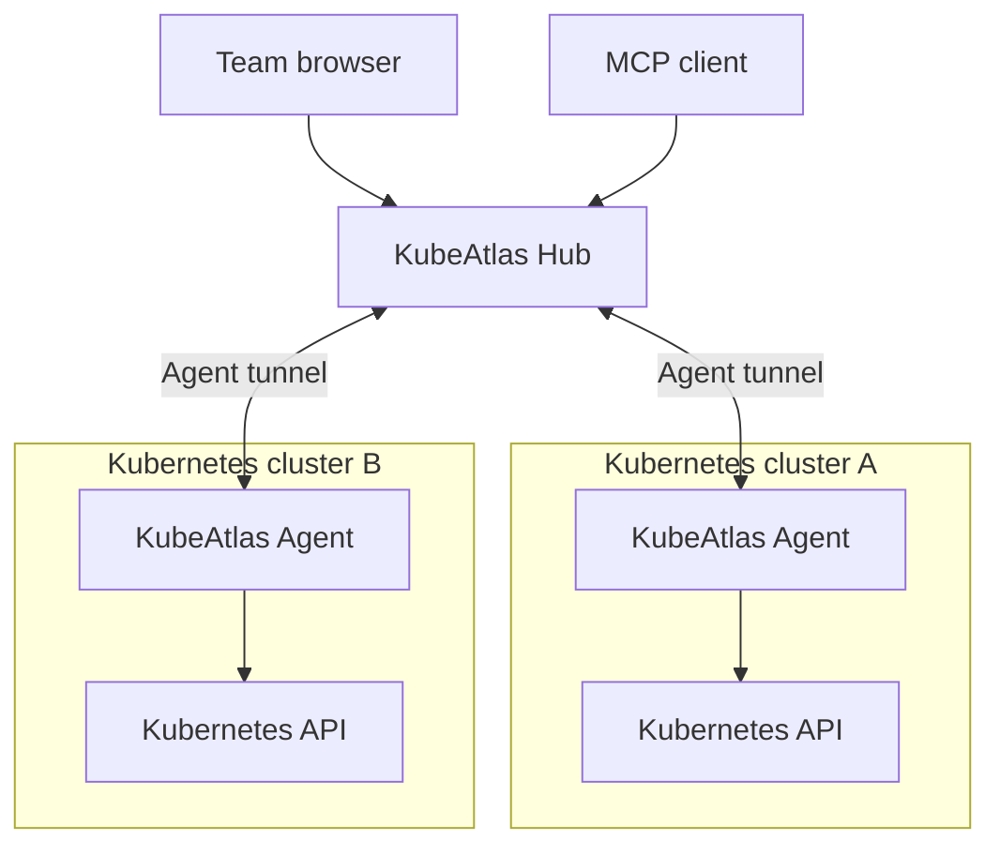

# KubeAtlas

**English** · [简体中文](README.zh-CN.md)

**A self-hosted operations console for Kubernetes.** Deploy KubeAtlas Hub and connect your clusters with KubeAtlas Agent to find failing workloads, trace dependencies, and see what changed.

[Releases](https://github.com/maomada/KubeAtlas/releases/latest) · [Deploy Hub](#deploy-hub) · [Connect a cluster](#connect-a-cluster) · [Deploy with AI](docs/deploy-with-ai.md)

**Hub** hosts the web console and manages organizations, cluster access, and MCP credentials. **Agent** runs in each cluster and opens an outbound connection to Hub. Cluster operations are scoped to the selected organization and enforced by Kubernetes RBAC.

## What you can do

- **Investigate issues** with workload health, logs, events, and a timeline of resource changes. [Cluster checks](docs/cluster-checks.md) · [Upgrade impact checks](docs/upgrade-impact.md)
- **Explore applications** and their resource dependencies, inspect live traffic when a source is available, and review Helm releases and Argo CD or Flux sync status. [Integrations](docs/integrations.md)
- **Review capacity and cost** with scheduling requests, node capacity, and cost allocation. If the cluster has a compatible Prometheus and the Hub has an offline bundle, you can install OpenCost from the Cost page. [Capacity](docs/capacity.md) · [Offline OpenCost](docs/opencost-offline.md)
- **Connect an AI client** over MCP using an expiring credential scoped to selected clusters and your permissions. [Hub MCP](docs/hub-live-mcp.md)

## Deploy Hub

Choose a release that provides the deployment artifacts for your environment. Hub runs on Linux `amd64` or `arm64`. Give it an HTTPS address reachable by the clusters you want to connect.

| Where you run Hub | Deployment guide |
| --- | --- |
| A Kubernetes cluster | [Helm](deploy/helm/kubeatlas-portal/README.md) |
| A Linux systemd host | [DEB or RPM](docs/deploy-with-ai.md#install-from-the-release-bundle) |
| A Linux container host | [Docker Compose](deploy/compose/README.md) |

## Connect a cluster

1. Sign in to Hub and select **Clusters → Connect cluster**.
2. Run the generated command in a shell with access to the intended Kubernetes context. Hub supplies the Agent installer, Helm chart, and image.
3. Approve the matching code in Hub and check that the cluster is **Connected**. [Agent onboarding](docs/hub-agent-onboarding.md#bootstrap-a-new-cluster)

To hand the setup to an AI agent, share the [deployment runbook](docs/deploy-with-ai.md) or its [raw Markdown](https://raw.githubusercontent.com/maomada/KubeAtlas/main/docs/deploy-with-ai.md).

## Contribute

[Development guide](DEVELOPMENT.md) · [Contributing](CONTRIBUTING.md) · [Discussions](https://github.com/maomada/KubeAtlas/discussions) · [Security reporting](SECURITY.md)

Licensed under [Apache 2.0](LICENSE). See [NOTICE](NOTICE) for attribution.
