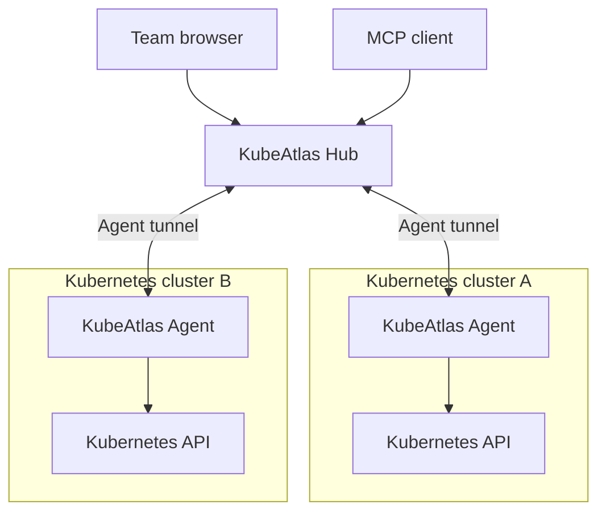

# KubeAtlas

**A self-hosted operations console for Kubernetes.** Connect your clusters to one Hub to find failing workloads, trace dependencies, and see what changed.

[Deploy the Hub](deploy/helm/kubeatlas-portal/README.md) · [Connect a cluster](docs/hub-agent-onboarding.md) · [Try one cluster](#try-one-cluster)



**Hub** hosts the web console and manages organizations, cluster access, and MCP credentials. **Agent** runs in each cluster and opens an outbound connection to Hub. Cluster operations are scoped to the selected organization and enforced by Kubernetes RBAC.

## What you can do

- **Investigate issues** with workload health, logs, events, and a timeline of resource changes. <a name="kubernetes-upgrade-impact"></a>[Upgrade impact checks](docs/upgrade-impact.md)
- **Explore applications** and their resource dependencies, inspect live traffic when a source is available, and review Helm releases and Argo CD or Flux sync status. [Integrations](docs/integrations.md)
- **Review capacity and cost** with scheduling requests, node capacity, and cost allocation. If the cluster has a compatible Prometheus and the Hub has an offline bundle, you can install OpenCost from the Cost page. [Capacity](docs/capacity.md) · [Offline OpenCost](docs/opencost-offline.md)
- **Connect an AI client** over MCP using an expiring credential scoped to selected clusters and your permissions. [Hub MCP](docs/hub-live-mcp.md)

## Get started

The **`0.1.0-rc.1` prerelease** is available as public container images and OCI Helm charts. [Packages](https://github.com/maomada?tab=packages) · [Publication record](https://github.com/maomada/KubeAtlas/actions/runs/44544344800)

Hub and Agent images run on Linux (`amd64` and `arm64`). Windows support ends for future releases.

### Connect your clusters

1. Deploy Hub with persistent storage and an HTTPS endpoint. [Hub Helm guide](deploy/helm/kubeatlas-portal/README.md)
2. Prepare the Agent bundle for the same version. Select **Connect cluster** in Hub, run the generated command against the target cluster, and approve its enrollment in Hub. [Agent onboarding guide](docs/hub-agent-onboarding.md)

### Try one cluster

Install the standalone console in your current Kubernetes context with Helm, then open `http://localhost:9280`.

```bash
helm upgrade --install kubeatlas oci://ghcr.io/maomada/charts/kubeatlas \
  --version 0.1.0-rc.1 --namespace kubeatlas --create-namespace
kubectl --namespace kubeatlas port-forward svc/kubeatlas 9280:9280
```

[In-cluster deployment](docs/in-cluster.md) · [Run from source](DEVELOPMENT.md#quick-start)

## Contribute

[Development guide](DEVELOPMENT.md) · [Contributing](CONTRIBUTING.md) · [Discussions](https://github.com/maomada/KubeAtlas/discussions) · [Security reporting](SECURITY.md)

Licensed under [Apache 2.0](LICENSE). See [NOTICE](NOTICE) for attribution.
