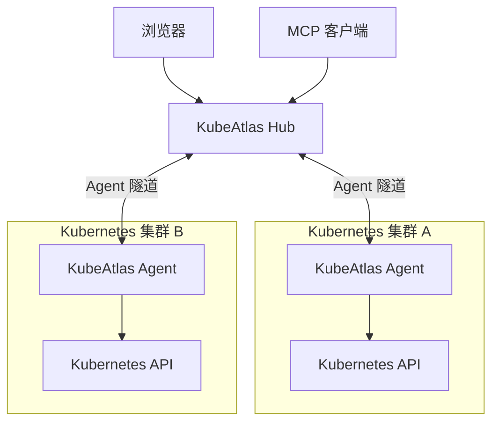

# KubeAtlas

[English](README.md) · **简体中文**

**面向 Kubernetes 的自托管运维控制台。** 通过一个 Hub 纳管多个集群，定位异常工作负载、查看应用依赖并追踪资源变更。

[下载安装包](https://github.com/maomada/KubeAtlas/releases/latest) · [试用单集群](#试用单集群) · [部署 Hub](#部署-hub) · [交给 AI 部署](docs/deploy-with-ai.md)



**Hub** 提供网页控制台，管理组织、集群访问权限和 MCP 凭据。**Agent** 运行在各集群中，主动连接 Hub。集群操作受当前组织的访问范围和 Kubernetes RBAC 约束。

## 主要功能

- **排查问题**。查看工作负载健康状态、日志、事件和资源变更时间线。[集群检查](docs/cluster-checks.md) · <a name="kubernetes-upgrade-impact"></a>[升级影响检查](docs/upgrade-impact.md)
- **查看应用和拓扑**。梳理资源依赖，查看 Helm 发布及 Argo CD 或 Flux 同步状态。接入流量数据源后可查看实时流量。[集成说明](docs/integrations.md)
- **查看容量和成本**。查看资源请求、节点容量和成本分配。集群具备兼容的 Prometheus 且 Hub 已配置离线包时，可在成本页安装 OpenCost。[容量](docs/capacity.md) · [OpenCost 离线安装](docs/opencost-offline.md)
- **接入 AI 客户端**。通过 MCP 访问所选集群，凭据设有有效期，操作受当前用户权限约束。[Hub MCP](docs/hub-live-mcp.md)

## 快速开始

[最新正式版](https://github.com/maomada/KubeAtlas/releases/latest) 提供 Linux `amd64` 和 `arm64` 的 DEB、RPM 安装包。单集群控制台使用 `kubeatlas`，共享 Hub 使用 `kubeatlas-portal`。

### 试用单集群

从发布页下载对应架构的 `kubeatlas` 安装包和 `checksums.txt`。校验并安装后，打开 `http://127.0.0.1:9280`。控制台使用你的 kubeconfig 连接集群。

```sh
# 以 Debian 或 Ubuntu 上的 amd64 版 v0.1.1 为例
package=kubeatlas_0.1.1_linux_amd64.deb
awk -v name="$package" '$2 == name' checksums.txt | sha256sum --check - &&
  sudo apt install "./$package" &&
  kubeatlas --listen-address 127.0.0.1 --port 9280 --no-browser
```

在使用 RPM 的发行版上，校验后运行 `sudo rpm -i ./<package>.rpm` 安装。[安装包说明](docs/packaging.md) · [从源码运行](DEVELOPMENT.md#quick-start)

### 部署 Hub

1. 安装对应架构的 `kubeatlas-portal` 安装包，配置管理员凭据、持久化状态文件和 HTTPS 地址。[Hub 部署步骤](docs/deploy-with-ai.md#3-run-a-shared-hub)
2. 准备与 Hub 同版本的 Agent 安装产物，在 Hub 中选择 **连接集群**。针对目标 Kubernetes 上下文运行生成的命令，再在 Hub 中批准配对。[Agent 注册指南](docs/hub-agent-onboarding.md)

安装包与 [OCI Helm Chart](https://github.com/maomada?tab=packages) 独立发布。使用 Helm 部署时，请选择已发布的 Chart 版本。[Helm 部署指南](deploy/helm/kubeatlas-portal/README.md)

如需让 AI 协助部署，可把 [AI 部署手册（英文）](docs/deploy-with-ai.md) 或 [原始 Markdown](https://raw.githubusercontent.com/maomada/KubeAtlas/main/docs/deploy-with-ai.md) 交给它。

## 参与贡献

[开发指南](DEVELOPMENT.md) · [贡献说明](CONTRIBUTING.md) · [讨论区](https://github.com/maomada/KubeAtlas/discussions) · [报告安全问题](SECURITY.md)

本项目采用 [Apache 2.0](LICENSE) 许可证。归属声明见 [NOTICE](NOTICE)。
