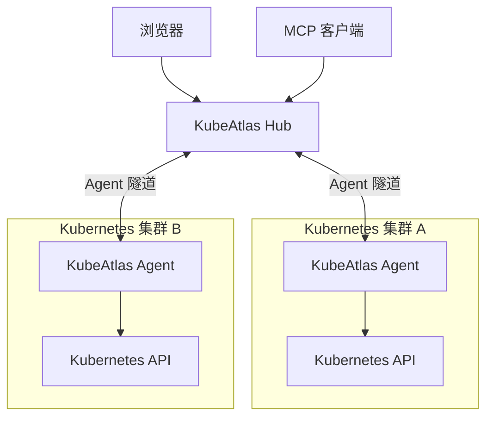

# KubeAtlas

[English](README.md) · **简体中文**

**面向 Kubernetes 的自托管运维控制台。** 部署 KubeAtlas Hub，用 KubeAtlas Agent 接入集群，即可定位异常工作负载、查看应用依赖并追踪资源变更。

[发布页](https://github.com/maomada/KubeAtlas/releases/latest) · [部署 Hub](#部署-hub) · [接入集群](#接入集群) · [交给 AI 部署](docs/deploy-with-ai.md)

**Hub** 提供网页控制台，管理组织、集群访问权限和 MCP 凭据。**Agent** 运行在各集群中，主动连接 Hub。集群操作受当前组织的访问范围和 Kubernetes RBAC 约束。

## 主要功能

- **排查问题**。查看工作负载健康状态、日志、事件和资源变更时间线。[集群检查](docs/cluster-checks.md) · [升级影响检查](docs/upgrade-impact.md)
- **查看应用和拓扑**。梳理资源依赖，查看 Helm 发布及 Argo CD 或 Flux 同步状态。接入流量数据源后可查看实时流量。[集成说明](docs/integrations.md)
- **查看容量和成本**。查看资源请求、节点容量和成本分配。集群具备兼容的 Prometheus 且 Hub 已配置离线包时，可在成本页安装 OpenCost。[容量](docs/capacity.md) · [OpenCost 离线安装](docs/opencost-offline.md)
- **接入 AI 客户端**。通过 MCP 访问所选集群，操作受当前用户权限约束。[Hub MCP](docs/hub-live-mcp.md)

## 部署 Hub

从 [v0.1.4](https://github.com/maomada/KubeAtlas/releases/tag/v0.1.4) 起，Linux 安装包内置 systemd 服务和同版本 Agent 离线包。按发行版和 CPU 架构下载一个安装包即可。

| Linux 发行版 | `amd64` 安装示例 |
| --- | --- |
| Debian 或 Ubuntu | `sudo apt install ./kubeatlas-portal_0.1.4_linux_amd64.deb` |
| RPM 系发行版 | `sudo dnf install ./kubeatlas-portal_0.1.4_linux_amd64.rpm` |

Hub 服务默认监听 `127.0.0.1:1333`。配置集群可访问的 HTTPS 地址，然后在浏览器用一次性设置码创建平台管理员。[Linux 配置和升级指南](docs/packaging.md#configure-https)

[Helm](deploy/helm/kubeatlas-portal/README.md) · [Docker Compose](deploy/compose/README.md) · [v0.1.3 部署指南](https://github.com/maomada/KubeAtlas/blob/v0.1.3/docs/deploy-with-ai.md)

## 接入集群

1. 登录 Hub，选择 **集群 → 连接集群**。
2. 在能访问目标 Kubernetes 上下文的终端运行 Hub 生成的命令。Agent 的安装脚本、Helm 包和镜像均由 Hub 提供。
3. 回到 Hub 审批对应的配对码，确认集群显示 **已连接**。[Agent 注册指南](docs/hub-agent-onboarding.md#bootstrap-a-new-cluster)

如需让 AI 协助部署，可把 [AI 部署手册](docs/deploy-with-ai.md) 或 [原始 Markdown](https://raw.githubusercontent.com/maomada/KubeAtlas/main/docs/deploy-with-ai.md) 交给它。

## 参与贡献

[开发指南](DEVELOPMENT.md) · [贡献说明](CONTRIBUTING.md) · [讨论区](https://github.com/maomada/KubeAtlas/discussions) · [报告安全问题](SECURITY.md)

本项目采用 [Apache 2.0](LICENSE) 许可证。归属声明见 [NOTICE](NOTICE)。
